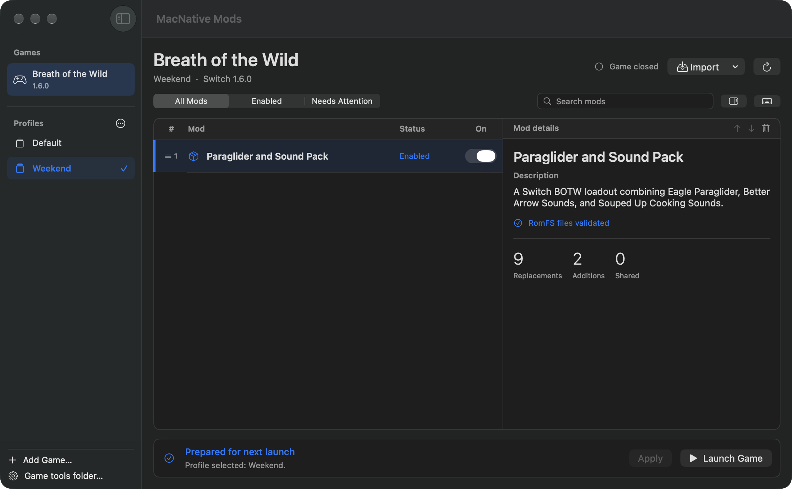

# MacNative Mods

A standalone Mac app for managing mods on supported [MacNativeGames](https://github.com/ly05010419/MacNativeGames) builds. Import your mods, set the load order, and launch the game with the profile you picked.

**[Download 0.2.4 beta](https://github.com/christianfurr/macnative-mods/releases/tag/v0.2.4)** · [Watch the 30-second demo](https://christianfurr.github.io/macnative-mods/#demo) · [Browse tested mods](https://christianfurr.github.io/macnative-mods/catalog.html)

Apple silicon · macOS 26 or later · Python 3.14 · A compatible MacNativeGames game and helper checkout



## Get a mod running

If you use Homebrew and need Python 3.14, run `brew install python@3.14`. [Homebrew package](https://formulae.brew.sh/formula/python@3.14)

1. **Install the app.** Download `MacNative.Mods.zip`, unzip it, and drag **MacNative Mods.app** to Applications. The beta is ad hoc signed. If macOS blocks the first launch, follow [Apple’s Open Anyway instructions](https://support.apple.com/en-us/102445).
2. **Select your game.** Pick an installed build in the sidebar or choose **Add Game…**. If asked for game tools, select a MacNativeGames checkout at `b1a49a2` or `9fe3fdc` through **Game tools folder…**. See [setup and requirements](docs/MODS.md).
3. **Import and launch.** Choose **Import…** and select a Switch RomFS folder, ZIP, or 7z. Enable the mod, quit the game if it’s running, then click **Apply & Launch**. On BOTW 1.6.0, use **Add demo mods** in the import menu to try a title-screen change or an Apple icon recolor generated from your own game files.

## What you can do

- **Switch loadouts.** Keep separate profiles for different playthroughs or mod combinations. Each remembers which mods are enabled and their order. Share a `.macnativeprofile` file with someone who already has the matching packs.
- **See which mod wins.** Drag mods to reorder them and check **Needs Attention** for dependency or compatibility issues. When two enabled mods replace the same file, the later mod generally wins. BOTW 1.6.0 resource-size tables merge where compatible.
- **Import Switch mod packs.** Use complete base-game RomFS packs or merged Switch exports from BCML and UKMM. BOTW 1.6.0 can also merge compatible Switch BNP packs after you install the [optional BCML runtime](docs/MODS.md#bcml-and-ukmm). The guide covers format limits, including Wii U packs, DLC-title overlays, and ExeFS patches.

## Game compatibility

| Game | Recognized versions | Test coverage |
| --- | --- | --- |
| Breath of the Wild | 1.6.0, 1.9.0 | Two three-pack loadouts reached gameplay on 1.6.0. Both versions passed synthetic overlay tests. |
| Tears of the Kingdom | 1.0.0, 1.2.1, 1.4.3 | Synthetic overlay tests. |
| Octopath Traveler 0 | 1.0.3, 1.0.4, 1.0.5 | Synthetic overlay tests. |

Start with **Breath of the Wild 1.6.0** for the best-tested setup. Mod compatibility depends on the game version, the files each mod changes, and how those mods interact. The [catalog](https://christianfurr.github.io/macnative-mods/catalog.html) lists tested loadouts and links to their creators.

## Troubleshooting

- **A mod won’t apply.** Open **Needs Attention** and check the message in the mod’s details. For a shared file, review which mod supplies it before changing the order.
- **The game closes after launch.** Quit the game, apply an empty profile, and try the game again. See the [backup and recovery guide](docs/MODS.md#validation-and-recovery) to restore the previous overlay. Profiles share the same game saves.
- **Need help?** [Open an issue here](https://github.com/christianfurr/macnative-mods/issues/new). Include your macOS version, game and version, the mod creator’s link, and the error text. Keep game files, keys, saves, and personal paths out of the report.

## Build from source

On an Apple silicon Mac with Xcode command-line tools and Python 3, run:

```sh
python3 -B -m unittest discover -s scripts -p 'test_mod_*.py'
bash scripts/build-mod-manager.sh
```

The app, ZIP, and checksum appear under `build/`.

For a notarized distribution build, set `MACNATIVE_MODS_DEVELOPER_ID` to the full **Developer ID Application** signing identity and `MACNATIVE_MODS_NOTARY_PROFILE` to a configured `notarytool` keychain profile before running the build script. It signs, submits, staples, and checks the app with Gatekeeper before packaging the ZIP. [Apple’s notarization guide](https://developer.apple.com/documentation/security/notarizing-macos-software-before-distribution)

MacNative Mods is an independent, MIT-licensed companion. It uses the existing MacNativeGames RomFS loader and your local game installation. [License](LICENSE) · [Third-party notices](THIRD_PARTY_NOTICES.md)
